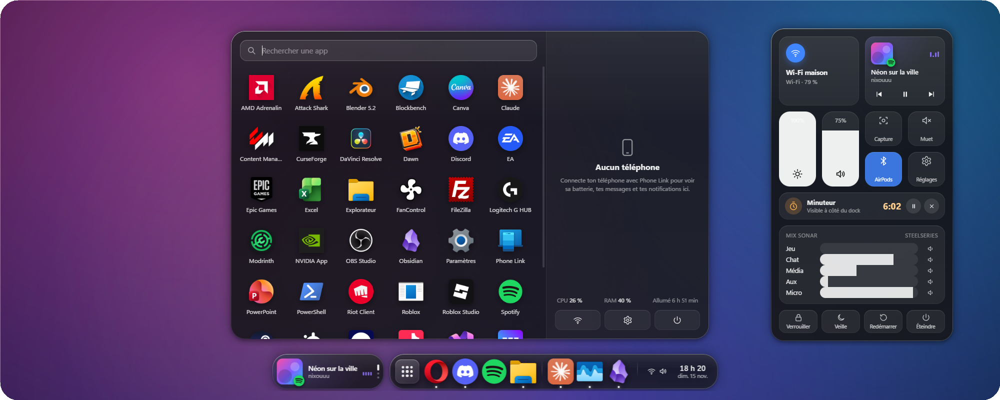
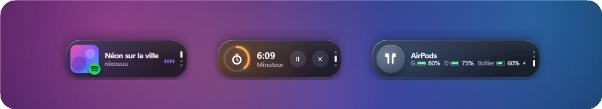

# Glass Dock

<a href="README.md">🇫🇷 Français</a> · 🇬🇧 English

### The taskbar Windows should have had.

A dark glass dock, smooth and animated, that replaces the Windows 10 and 11 taskbar.

 

Free · No account · Automatic updates · Clean uninstall

 

 

|  |  |
|---|---|
| 🪟 **A real dock** Magnification, bouncing icons, a glow of light on hover. Your pinned and open apps, in one place. | ✨ **Glass Live** Your music, a timer, your AirPods battery. Swipe the pill to switch between them. |
| 🎛️ **Control Center** Wi-Fi, Bluetooth, sound, brightness, timer. Everything one click away, no digging through settings. | ⚡ **Windows key** The dock shows up over everything, even in fullscreen. The app menu finds any app as soon as you type. |

 

## Install in 30 seconds

1. **[Download Glass Dock](https://github.com/Nixouuu/glass-dock/releases/latest/download/Glass-Dock-Setup.exe)**.
2. Open the file and follow the welcome screen (Quick or Customize).
3. That's it. New versions arrive on their own.

> Windows may show "Windows protected your PC": that's normal for an independent app that isn't signed yet. Click **More info**, then **Run anyway**.

## Questions

<b>Does it touch my data?</b>

 
No. Glass Dock only runs on your PC. No account, no ads, nothing is sent. The only connection checks whether a new version is out.

<b>What if I want the Windows taskbar back?</b>

 
Windows Settings → Apps → <b>Glass Dock</b> → Uninstall. The taskbar comes back exactly as it was.

<b>Does it work with my AirPods?</b>

 
Yes: connect and disconnect in one click. With <a href="https://apps.microsoft.com/search?query=magicpods">MagicPods</a> installed, you also see the left, right and case battery.

<b>I use SteelSeries Sonar, does it work?</b>

 
Yes! Glass Dock controls Sonar directly: master volume and the Game / Chat / Media / Aux / Mic mix in the Control Center. Without Sonar, it uses the Windows volume.

<b>Is it in French too?</b>

 
Yes: Glass Dock is in English and French. It follows your Windows language, and you can switch in Settings.

<b>Is it really free?</b>

 
Yes, and it will stay that way. No ads, no paid version. If you like Glass Dock, you can <a href="https://ko-fi.com/glassdock">buy me a coffee on Ko-fi</a>: totally optional, it helps me keep going.

<b>How do I get new features?</b>

 
Automatically: the dock offers to restart, then shows you what changed. Every version is in the <a href="https://github.com/Nixouuu/glass-dock/releases">Releases</a>.

 

Made with care by <b>nixouuu</b> · <a href="https://github.com/Nixouuu/glass-dock/releases">What's new</a> · <a href="https://ko-fi.com/glassdock">☕ Support</a>

