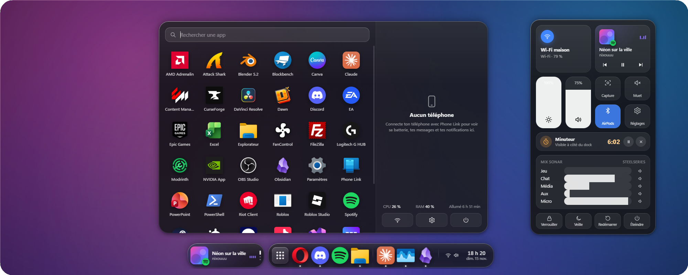
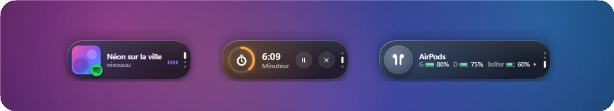

# Glass Dock

### La barre des tâches que Windows aurait dû avoir.

Un dock en verre sombre, fluide et animé, qui remplace la barre des tâches de Windows 10 et 11.

 

Gratuit · Sans compte · Mises à jour automatiques · Désinstallation propre

 

 

|  |  |
|---|---|
| 🪟 **Un vrai dock** Effet loupe, icônes qui rebondissent, halo de lumière au survol. Tes apps épinglées et ouvertes, au même endroit. | ✨ **Glass Live** Ta musique, un minuteur, la batterie de tes AirPods. Glisse la pastille pour passer de l'un à l'autre. |
| 🎛️ **Centre de contrôle** Wi-Fi, Bluetooth, son, luminosité, minuteur. Tout est à un clic, sans fouiller dans les paramètres. | ⚡ **Touche Windows** Le dock apparaît par-dessus tout, même en plein écran. Le menu Apps trouve n'importe quelle app dès que tu tapes. |

 

## Installer en 30 secondes

1. **[Télécharge Glass Dock](https://github.com/Nixouuu/glass-dock/releases/latest/download/Glass-Dock-Setup.exe)**.
2. Ouvre le fichier et suis l'accueil (Rapide ou Personnaliser).
3. C'est tout. Les nouvelles versions arrivent toutes seules.

> Windows peut afficher « Windows a protégé votre ordinateur » : c'est normal pour une app indépendante, pas encore signée. Clique **Informations complémentaires**, puis **Exécuter quand même**.

## Questions

<b>Est-ce que ça touche à mes données ?</b>

 
Non. Glass Dock tourne seulement sur ton PC. Aucun compte, aucune pub, rien n'est envoyé. La seule connexion sert à vérifier s'il y a une nouvelle version.

<b>Et si je veux revenir à la barre des tâches de Windows ?</b>

 
Paramètres Windows → Applications → <b>Glass Dock</b> → Désinstaller. La barre des tâches revient exactement comme avant.

<b>Ça marche avec mes AirPods ?</b>

 
Oui : connecter et déconnecter en un clic. Avec <a href="https://apps.microsoft.com/search?query=magicpods">MagicPods</a> installé, tu vois aussi la batterie gauche, droite et du boîtier.

<b>C'est vraiment gratuit ?</b>

 
Oui, et ça va le rester. Pas de pub, pas de version payante. Si tu aimes Glass Dock, tu peux <a href="https://ko-fi.com/glassdock">m'offrir un café sur Ko-fi</a> : totalement optionnel, ça m'aide à continuer.

<b>Comment je reçois les nouveautés ?</b>

 
Automatiquement : le dock te propose de redémarrer, puis te montre ce qui a changé. Toutes les versions sont dans les <a href="https://github.com/Nixouuu/glass-dock/releases">Releases</a>.

 

Fait avec soin par <b>nixouuu</b> · <a href="https://github.com/Nixouuu/glass-dock/releases">Nouveautés</a> · <a href="https://ko-fi.com/glassdock">☕ Soutenir</a>

