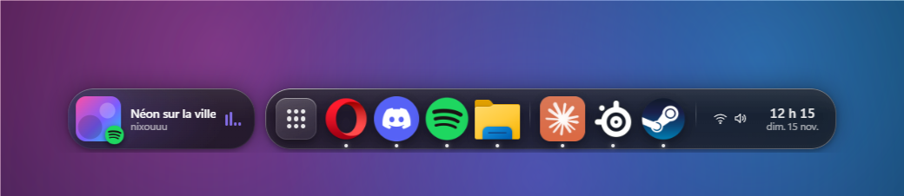
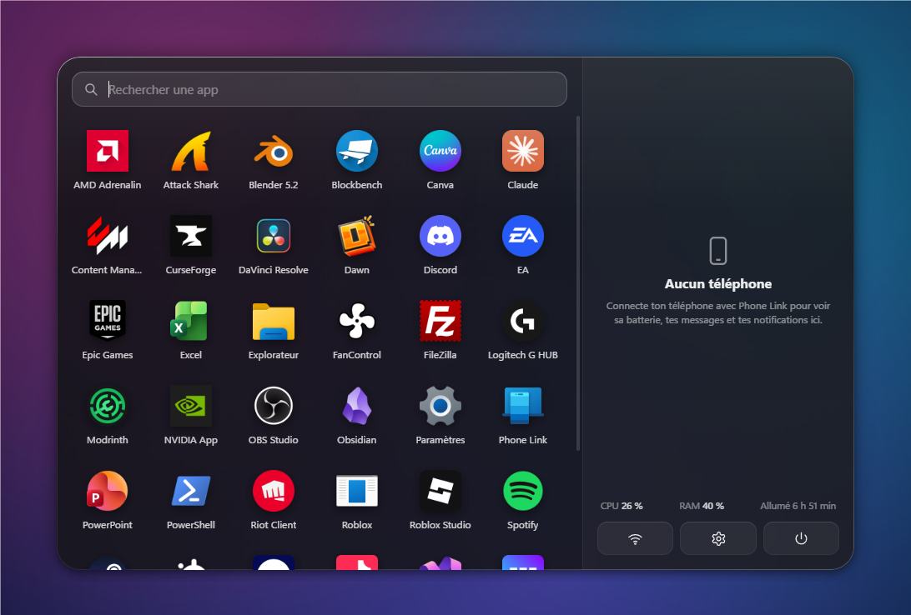
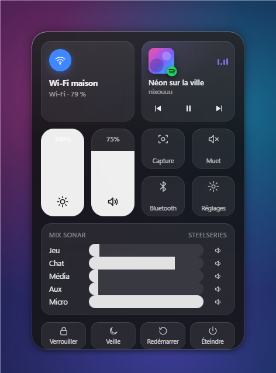
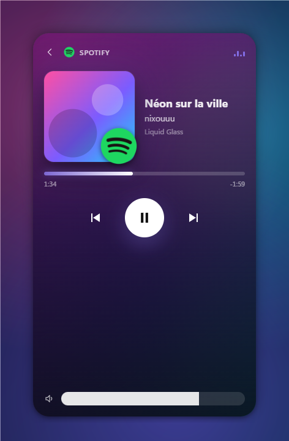
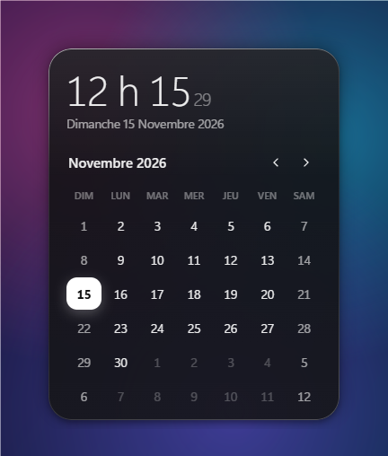
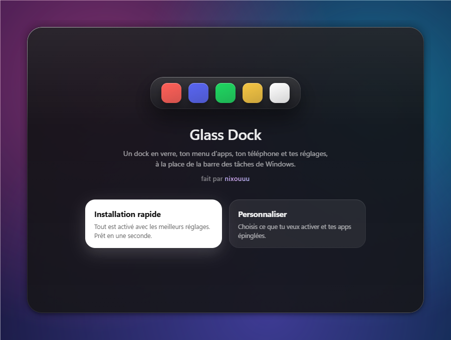

# Glass Dock

**Un dock sombre façon *liquid glass* qui remplace la barre des tâches de Windows 11.**

Windows 10/11 · gratuit · mises à jour automatiques · par nixouuu

 

## Ce que ça fait

- **Dock avec effet loupe** : tes apps épinglées, puis les apps ouvertes, triées par utilisation récente.
- **Touche Windows** : le dock apparaît par-dessus tout, même en plein écran. Un clic ailleurs le range.
- **Menu « Toutes les apps »** : tu tapes direct pour chercher, et la recherche couvre toutes les apps du PC.
- **Centre de contrôle** : Wi-Fi, son (SteelSeries Sonar pris en charge), luminosité des écrans, capture, alimentation.
- **Lecteur musique** : pastille à côté du dock dès que ça joue (Spotify, YouTube…), avec la pochette et les couleurs de l'album.
- **Appels** : une pastille pour revenir à ton appel Discord, Teams, Zoom…
- **Plusieurs écrans** : petite horloge discrète sur les autres écrans, et les apps restent sur leur écran.
- **Désinstallation propre** : la barre des tâches de Windows revient comme avant.

  

## Installer

1. Télécharge **[Glass-Dock-Setup.exe](https://github.com/Nixouuu/glass-dock/releases/latest/download/Glass-Dock-Setup.exe)**.
2. Lance-le. Si Windows affiche « Windows a protégé votre ordinateur », clique **Informations complémentaires** puis **Exécuter quand même** (l'app n'est pas signée, c'est normal pour un petit projet).
3. Choisis **Rapide** ou **Personnaliser**, et c'est parti.

Les mises à jour arrivent toutes seules : le dock te propose de redémarrer, puis te montre ce qui est nouveau.

## Désinstaller

Paramètres Windows → Applications → **Glass Dock** → Désinstaller. La barre des tâches revient comme avant.
